# Ülesannete lahendus

Kõik sammud on tehtud GitHub Codespaces'is. Iga Red ja Green etapp on eraldi commit
(vt [commitide ajalugu](https://github.com/Miron-maxxing/unit-test-praktikum-miron/commits/main)).

---

# OSA A. Parooli valideerimine (`password.js`)

## Red – testid enne parandust

Lisasin `password.test.js` faili kuus testi ja `test.each` ploki. Kaks testi ebaõnnestusid:
täpselt 8 märgiga parool `'abcdefgh'` – **Expected: true, Received: false**.

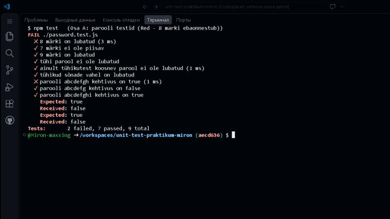

**Põhjus:** funktsioonis oli tingimus `password.length > 8`, seega 8 märki ei loetud
piisavaks. Nõue on „vähemalt 8 märki“. 9 märgiga parool läbis testi ka vigase koodiga,
sest viga oli täpselt piirväärtusel.

## Parandus

`>` asendasin `>=`-ga:

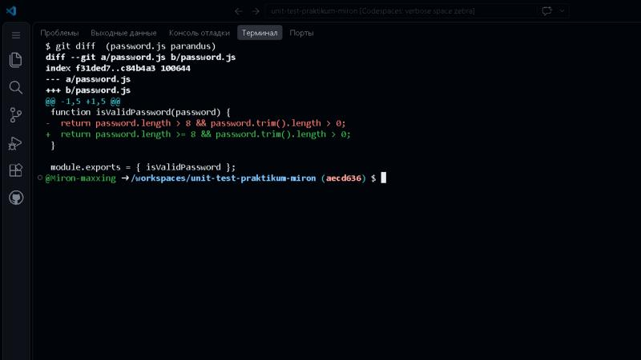

## Green – kõik parooli testid läbivad

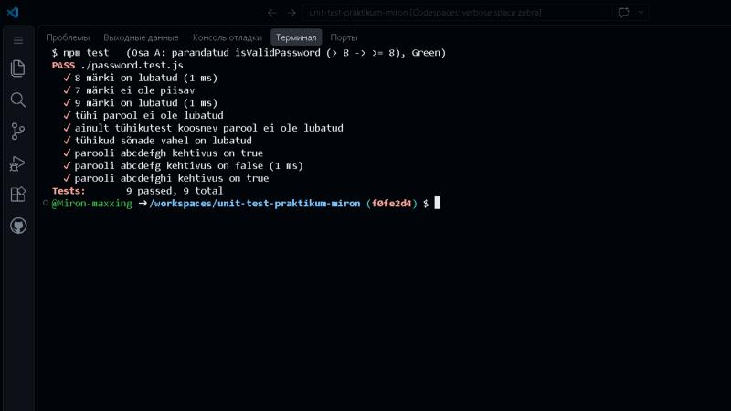

---

# OSA B. Ostukorvi summa (`cart.js`)

## Red – testid enne parandust

Lisasin tabelist kõik testid, `test.each` ploki ja `toThrow()` testi. Kaks testi ebaõnnestusid:

- `[{ price: 100, qty: 1 }]` + `STUDENT10` – **Expected: 90, Received: 95**
- `[{ price: 100, qty: 1 }]` – **Expected: 100, Received: 105**

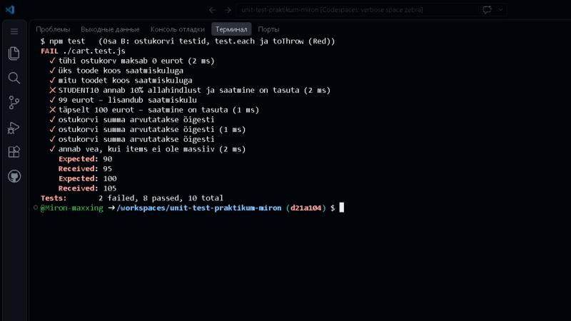

**Põhjus:** saatmiskulu tingimus oli `total <= 100`, seega ka täpselt 100 € ostule lisati 5 €.
Lisaks kontrolliti saatmist pärast allahindlust (100 € → 90 € → lisandus saatmiskulu).

## Parandus

Jätsin ostusumma enne allahindlust meelde (`subtotal`) ja saatmine on tasuta, kui
`subtotal >= 100`:

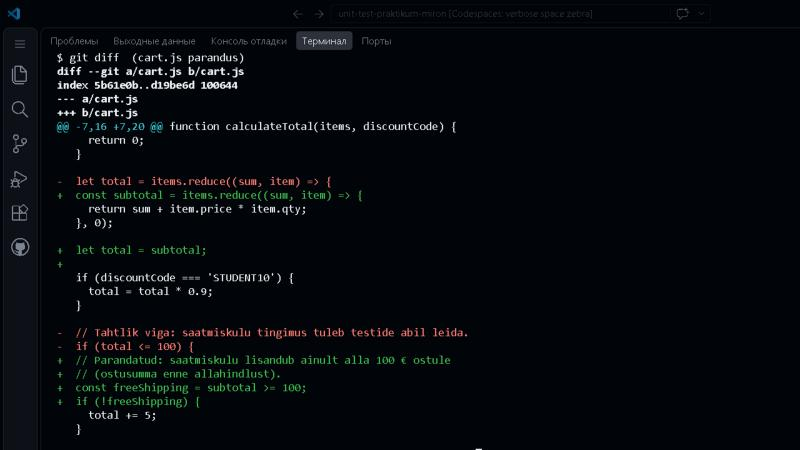

## Green – kõik ostukorvi testid läbivad

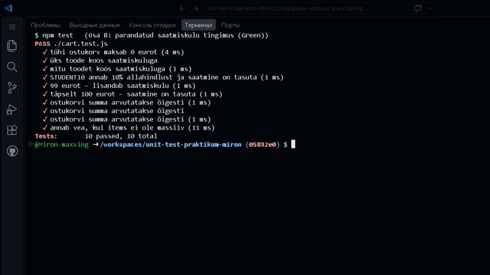

## npm run coverage

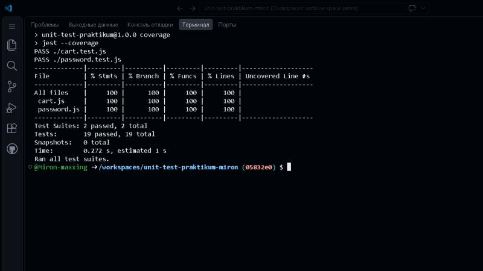

100% katvus näitab, et testid käivitasid kogu koodi, aga see ei tõesta, et kood on veatu.

---

# OSA C. TDD – sooduskood FREESHIP

TDD (Test-Driven Development) tähendab, et kõigepealt kirjutatakse test uue nõude kohta
ja alles siis kood, mis selle nõude täidab.

## Red – test enne koodi

Test `calculateTotal([{ price: 10, qty: 1 }], 'FREESHIP')` ootab 10 €, aga funktsioon
lisas veel saatmiskulu: **Expected: 10, Received: 15**.

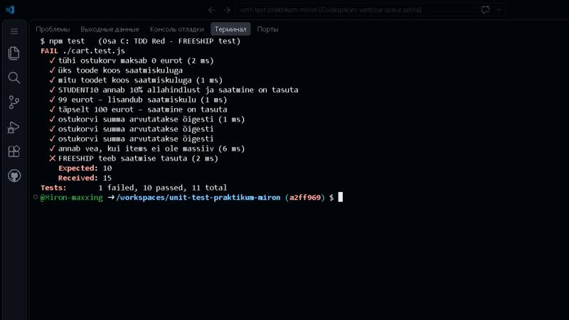

## Green – koodi muudatus

Lisasin saatmise tingimusse `discountCode === 'FREESHIP'`:

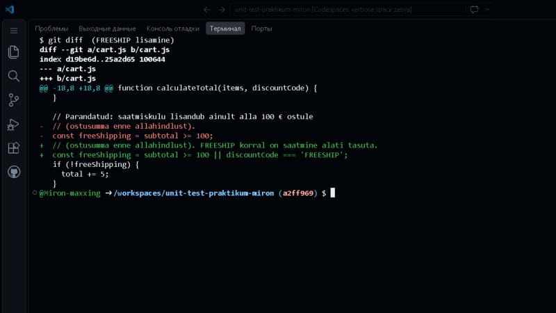

## Regressioonikontroll

Kõik 20 testi läbivad – FREESHIP töötab ja varasemad nõuded (STUDENT10, saatmiskulu,
tühi ostukorv, vigane sisend) ei läinud katki.

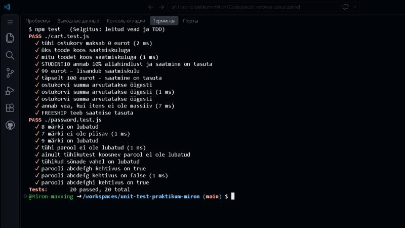

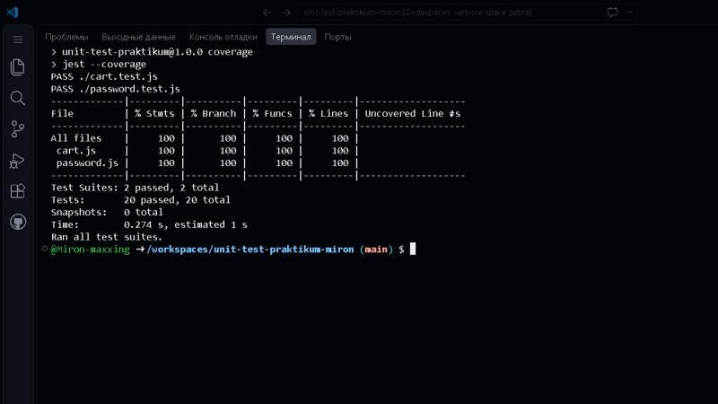

## Refactor

Saatmise tingimus on eraldi muutujas `freeShipping`, et kood oleks loetavam.
Pärast seda läbisid endiselt kõik testid.
